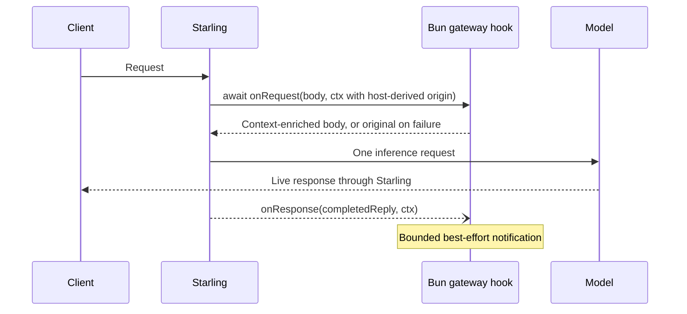

# 异步网关 hook

可选启用的 Bun hook 在路由前补充外部上下文，并观察已完成的回复。网关对每个客户端请求只发一次模型请求。工具声明、工具执行以及后续的推理轮次都归客户端负责。



## 入口与请求契约

在 package.json 里声明 `"starling": {"hooks": "./context.hooks.ts"}`，或者用 `starling plugin add` 安装一个 `*.hooks.js`、`.mjs`、`.ts` 或 `.mts` 文件。这些名字与 JS 网关 middleware 的（`starling.middleware`、它的别名 `starling.gateway`、`*.gateway.js`）不同，所以一个 import 了 `node:fs` 的 hook 不会再被当作 middleware 加载。Bun 直接运行 TypeScript。纯网关的包不需要 provider 的 main/exports，也不需要客户端 MCP 安装或客户端 skill。

`export async function onRequest(body, ctx)` 在路由前拿到客户端协议的 JSON。返回一个 JSON 对象以补充上下文；返回 `undefined` 则保持原样。当 hook 抛异常、超时、返回非法数据，或改动了客户端的工具声明、tool choice、`model` 或 `stream` 时，这些改动都会被回滚（网关已经拿调用方的 key 对照模型做过校验，而客户端读的是它自己请求的那份回复）。被回滚的 hook 记为失败，该请求不再有 `onResponse`。它不能拒绝请求，也不能注册工具。同步的 middleware API 仍然单独可用。

上下文字段：`protocol`（`chat`、`responses`、`anthropic`、`gemini`）、`model`、`stream`、`path`、`origin`、`agent`、`session`、`cwd`、`query`、包级 `options`、请求私有 `state`、一个 `AbortSignal` 以及 `report(code, bytes)`。请求头和客户端凭据不会转发给 hook。query 提取保持模型原始输入完整，同时在召回时排除客户端的环境/指令说明。空的身份字段不得被当作已认证的用户身份。

`origin` 由宿主推导：直接回环请求、没有转发请求头也没有具名网关 key 时为 `local`；具名 key（包括在回环上使用的）为 `gateway-key`；其余为 `remote`。即使设置了 `STARLING_TRUST_PROXY=1`，转发来的流量仍然是 remote。不会暴露 key、key 名、对端地址或客户端自称的 origin。较旧的宿主没有 origin 时表示未知。这个分类不是用户身份；导出对话的 plugin 必须自行取得明确授权，并默认跳过非 local 或未知的 origin。两个生命周期回调里都能拿到它。

`gatewayTimeoutMs` 选项接受 100–10000 毫秒（默认 1000 毫秒）。整条请求 hook 链的时限是十秒，宿主启动/RPC 的时限是十一秒，其中包括在 provider 发现期间等待一个正在启动的宿主。首个请求在这个预算内等待，而不是因为启动占着宿主锁就跳过它的 hook。客户端取消会中止等待和请求 hook 的 I/O。hook 按 plugin 顺序执行。失败时保留上一次被接受的请求；诊断信息里是固定的结果码和字节数，不含私有内容。

## 完成通知

`export async function onResponse(reply, ctx)` 是可选的。它在响应 middleware 写完之后观察面向客户端的回复。流式字节立即转发；另有一份有界的副本，只为这个回调按该协议的响应形态合并，走的是网关翻译时用的同一套解码器、收集器和渲染器（Responses 流里的 `response.completed` 响应就是回复本身）。该回调不能改写客户端输出。`ctx.request` 装着被接受的请求，`ctx.success` 报告是否完成，每个 hook 各自的 `ctx.state` 把召回和捕获关联起来。

通知是即发即弃的，用的是一个与已结束的 HTTP 请求无关的全新超时信号。它从不在返回客户端 EOF 之前等待观察者的网络操作。这次运行随请求处理器结束，而不是随客户端连接结束：客户端在回复完整之后挂断（Codex 在 `response.completed` 时关闭）仍能得到一次成功捕获。请求失败、流不完整（包括客户端在回复中途消失）或捕获超过 8 MiB，都会让捕获不成功（`success: false`，回复可能为 null）。这是尽力而为的投递，不是持久队列：关机、宿主退役和容量上限都可能丢弃通知。hook 不得盲目重试非幂等的外部写入。

宿主的请求状态最多容纳 128 次运行，15 分钟后过期。响应 RPC 的时限是十一秒；每个回调使用配置的（有界的）hook 超时。通知发出后，请求持有的状态被释放。

## 来源与验证

- `internal/plugin/gateway.go`：入口发现、取消、完成分发。
- `internal/plugin/host.js`：异步执行、回滚、状态与时限。
- `internal/gateway/middleware.go`：`gatewayHooks`，在路由前和 middleware 前后运行，这样 `onResponse` 看到的就是 Agent 拿到的东西。`serveAgent` 对每个 Agent 请求都运行它；Codex 自己的 ChatGPT 登录透传（`codex_backend.go`）则不带同步 middleware 运行它。
- `internal/gateway/gateway_hooks.go`：有界的响应观察和 `gatewayReply`，把一个流合成一条回复。
- `internal/plugin/gateway_test.go` 和 `internal/gateway/gateway_hook_test.go`：失败、取消、归属和真实的 HTTP 流式传输。

按 [provider plugin 验证](provider-plugins.md#verification) 使用隔离的 HOME 和解析好的 Go/Bun 可执行文件。定向的 race 验收：

```sh
go test -race -tags nogui ./internal/plugin ./internal/gateway -run '^TestGateway|^TestAsyncGateway' -count=1
```

服务部署、自动安装和由网关自有的工具循环都不在这份契约之内。一个具体的配套集成是：通过 `/v1/context/prepare` 做 PowerContext 召回，通过 `/v1/sources/content` 捕获对话。
